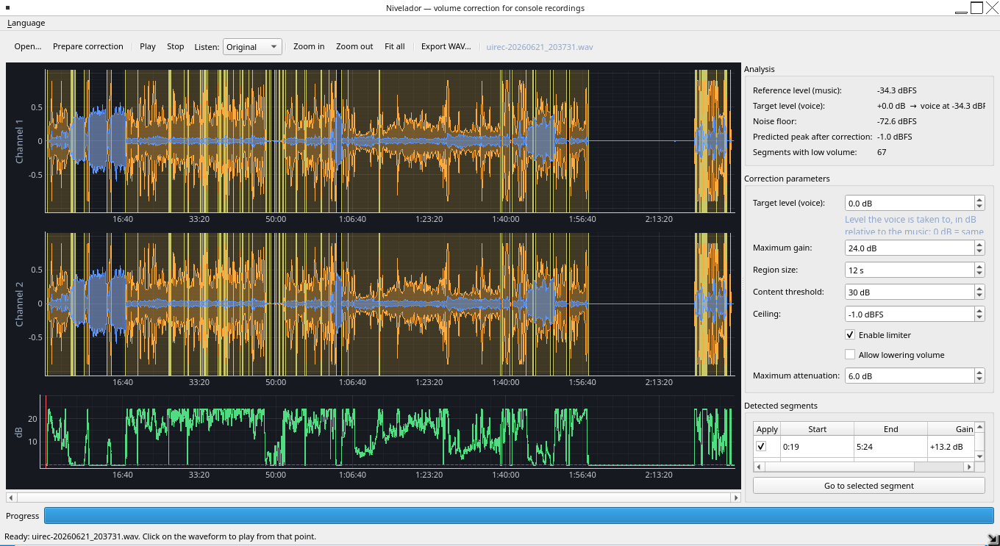

# SoundCraft UI16 Leveler

Non-destructive audio leveler for SoundCraft UI16 console recordings: it finds
the stretches where the volume is too low (usually the sermon), previews the
planned correction right over the waveform, lets you compare original vs.
corrected, and exports a new WAV without ever modifying the original file.

## The problem

A service recording usually has two very different levels on the same file: the
worship band, mixed close to full scale, and the sermon, often around 10 % of
that level. Raising the whole file would clip the music; raising only the quiet
part by hand, minute by minute, takes a long time over a 150-minute recording.

This tool measures the music level, uses it as the reference, and brings the
quiet stretches up to a target level expressed **in dB relative to the music**
(`0 dB` = the voice ends up level with the music, negative = quieter than the
music, positive = louder).

## Features

- **Waveform view like Audacity** per channel, with the correction drawn as an
  orange mask over the original blue waveform, so the result is visible before
  rendering anything.
- **Region-based analysis** (12 s window by default): the gain follows the
  long-term level of each stretch, not the word-by-word dynamics, which avoids
  the pumping effect and does not amplify silence or background noise.
- **Target level in dB relative to the music**, adjustable on the fly.
- **Detected segments table**: every stretch that needs a boost, with its gain;
  each one can be enabled/disabled individually and there is a button to jump to
  it on the waveform.
- **A/B listening**: flip between *Original* and *Corrected* while playing.
- **Click to play**: click anywhere on the waveform to start playing from that
  instant (useful to jump to the beginning of a song or of the sermon).
- **Soft limiter** with a configurable ceiling (−1 dBFS by default) and an
  estimated peak shown before exporting.
- **Fully non-destructive**: the input file is only read; the export is written
  to a new WAV at the original sample rate and channel count.
- **Works with very large files**: a 1.7 GB / ~150 min recording is processed by
  blocks over an `mmap`, so memory use stays low.
- **Multilingual** interface (English source, reviewed with Qt Linguist; Spanish
  translation included).

## Requirements

- Python 3.9 or newer
- [PyQt6](https://pypi.org/project/PyQt6/) and [pyqtgraph](https://pypi.org/project/pyqtgraph/) ≥ 0.13
- [NumPy](https://pypi.org/project/numpy/) ≥ 1.20
- `ffmpeg` (optional, only to open formats other than 16/32-bit PCM or 32-bit
  float WAV; the console records 16-bit PCM, so it is not needed in practice)
- For translations: `pylupdate6`, `lrelease` and Qt Linguist (they ship with the
  Qt tools package)


## Installation with deb packages Debian/Ubuntu

Install dependencies:

```bash
sudo apt install ffmpeg python3-pyqtgraph python3-pyqt6 python3-numpy
```

then:

```bash
git clone https://github.com/<your-user>/soundcraft-ui16-leveler.git
cd soundcraft-ui16-leveler
```

## Run

```bash
python3 -m nivelador
```



## Installation with pip

```bash
pip install PyQt6 pyqtgraph numpy
```

The application is a Python package named `nivelador`, so it should live in a
folder with that name inside the repository:

```
soundcraft-ui16-leveler/
├── README.md
└── nivelador/
    ├── __main__.py
    ├── gui.py
    ├── analysis.py
    ├── audiofile.py
    ├── translations.py
    └── i18n/
        ├── nivelador_es.ts
        └── nivelador_es.qm
```

## Usage from pip

Run it from the folder that contains the `nivelador` package:

```bash
python3 -m nivelador
# or open a recording straight away
python3 -m nivelador "/path/to/service.wav"
```

1. **Open…** (`Ctrl+O`) and pick the recording. The file is analyzed while the
   progress bar runs; large files take a while but never block the interface.
2. Look at the orange mask over the waveform: that is the expected result. The
   right panel shows the reference level (music), the target level (voice), the
   noise floor, the predicted peak and the number of quiet segments.
3. **Click on the waveform** to start playing from that point, or use **Play** /
   **Pause** (`Space`) and **Stop**.
4. Press **Prepare correction** and switch the *Listen* selector to **Corrected**
   to compare it with the **Original** (A/B).
5. Adjust *Target level (voice)* and the rest of the parameters until it sounds
   right; the table and the mask update immediately.
6. **Export WAV…** (`Ctrl+E`) to write the corrected file (default name:
   `<original>_nivelado.wav`).

### Shortcuts

| Shortcut | Action |
| --- | --- |
| `Ctrl+O` | Open a recording |
| `Ctrl+E` | Export the corrected audio |
| `Space` | Play / pause |

The mouse wheel zooms in and out around the pointer, dragging over the waveform
pans the view, and the horizontal scroll bar at the bottom moves along the whole
file.

## How it works

1. **Level per frame.** RMS and peak are measured in 0.4 s windows with a 0.2 s
   hop, on the mono mix of the file.
2. **Reference (music).** The level is smoothed with a 12 s moving average and
   the 90th percentile of the stretches that hold content is taken as the
   reference `ref_db`. Measuring the reference with the very same long window
   used by the correction is what makes `0 dB` mean real parity.
3. **Target (voice).** `target_db = ref_db + offset`, where the offset is the
   *Target level (voice)* parameter (0 dB by default).
4. **Gain curve.** For every frame the needed gain is `target_db − region_level`,
   clipped to the maximum gain and to the allowed attenuation. It is faded out
   where the region has no real content (below `ref_db − content_floor`), then
   smoothed asymmetrically (slow attack, fast release) and softened with a short
   moving average to avoid steps.
5. **Segments.** Frames whose gain exceeds 0.5 dB are grouped into segments,
   pauses shorter than 3 s are merged and stretches shorter than 1 s dropped.
6. **Limiter.** Before writing, the signal is limited to the ceiling (−1 dBFS by
   default) with a fast look-ahead style reduction, so a boosted voice never
   clips.
7. **Export.** The corrected audio is written block by block as 16-bit PCM WAV
   at the original sample rate and channel count.

### Parameters

| Parameter | GUI range | Default | Meaning |
| --- | --- | --- | --- |
| Target level (voice) | −30 … +12 dB | 0.0 dB | Level the voice is taken to, relative to the music |
| Maximum gain | 0 … 48 dB | 24 dB | Cap for the applied boost |
| Region size | 1 … 120 s | 12 s | Window used to measure the level of each region |
| Content threshold | 5 … 60 dB | 30 dB | Below `reference − value` the audio is treated as silence/noise and not amplified |
| Ceiling | −6 … 0 dBFS | −1 dBFS | Maximum output level of the limiter |
| Enable limiter | on/off | on | Turns the limiter on or off |
| Allow lowering volume | on/off | off | Allows attenuation, e.g. to bring a too loud stretch down |
| Maximum attenuation | 0 … 24 dB | 6 dB | Cap for the attenuation (only used when the previous option is on) |

Uncovered by the interface, in `analysis.py` (`Settings`): analysis window
0.4 s, reference percentile 90, attack 1.0 s, release 0.4 s, segment merge gap
3 s, minimum segment length 1 s.

## Languages

The source code is written in English and every visible string is wrapped in
`tr()`. Translations live in `nivelador/i18n/` and are edited with Qt Linguist.

```bash
# 1) Extract new or changed texts into the .ts file
pylupdate6 nivelador/*.py -ts nivelador/i18n/nivelador_es.ts

# 2) Review and translate
linguist nivelador/i18n/nivelador_es.ts

# 3) Compile it to a .qm (in Linguist: File > Release)
lrelease nivelador/i18n/nivelador_es.ts
```

A language appears in the **Language** menu as soon as its `.qm` file exists. The
interface starts in the system language when a translation is available, and in
English otherwise. To translate a new language, just replace `es` with the
language code (`pt`, `fr`, `de`, …) in the three commands above.

## Credits

Built for the sound team of a local church that records every service with a
SoundCraft UI16 console and a USB stick.
